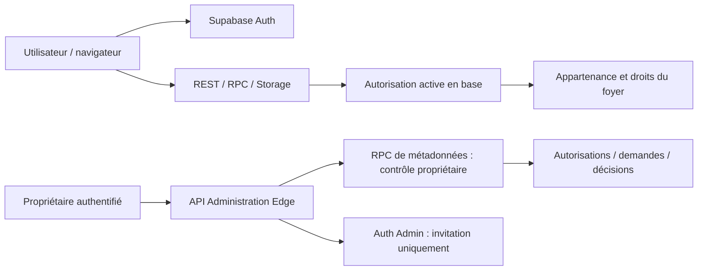

# DOBBY — administration privée : audit et conception

**17 novembre 2026 · DIAGNOSTIC. Proposition à valider pour une mission d’exécution distincte.**

**Publication documentaire pour revue :** document repris du commit local source `da11ac124be3d7abfc133a884f5751d11cf26552`, dans une branche indépendante créée depuis `origin/main` à `a637b8f9208a44479ccd87b82ba9d09d66cec75e`. Les observations et les 83 tests ci-dessous proviennent de l’audit précédent ; aucun test ni contrôle Supabase n’a été relancé pour cette publication. Seuls les deux documents sont publiés, sans leurs annexes locales. Un détail d’inventaire d’un compte Auth de test réel est remplacé par une règle générale de conservation sans auto-autorisation.

Référence historique inspectée pendant l’audit : `main` et `origin/main` = **`2f2f38b197a96ee2ae3593545f822002a452e859`**, identique à la référence V7 demandée. Cahier des charges : [issue #19](https://github.com/PortenartCo/dobby-demo/issues/19), relue sans commentaire existant à cette date. Projet personnel exclusivement : **`dobby-family-sync` / `pqcdkrwljgvgagzwrcmg`**.

## 1. Décision proposée et limites des preuves

**Conserver Supabase Auth, Postgres/RLS, Storage et les moteurs familiaux V7 ; ajouter une autorisation applicative centrale, consultée à chaque requête, et une petite API d’administration Supabase Edge Functions.** Le rôle familial `owner` ne devient jamais administrateur DOBBY. Aucun moteur IA, nouveau moteur de synchronisation ou transfert des données familiales vers la console.

L’ouverture aux amis doit attendre la validation du contrôle serveur complet. Fermer les inscriptions seules empêcherait les nouvelles créations Auth, mais ne traiterait ni les comptes déjà inscrits sans approbation, ni les invitations familiales, ni une suspension sous JWT valide.

| Niveau | Preuve et portée |
|---|---|
| **Observation distante de l’audit précédent** | Le 17/11 à **20:24 CET**, GET public Auth `/auth/v1/settings` : `disable_signup=false`, `mailer_autoconfirm=false`, e-mail activé, téléphone/OAuth/connexion anonyme désactivés dans la réponse. Aucun essai d’inscription, connexion ou envoi d’e-mail. |
| **Observation distante de l’audit précédent** | Dépôt déclaré **public** par GitHub. Six GET Pages HTTP 200, octets identiques à la référence : racine, `access.js`, `access-config.js`, `access-flow.mjs`, `family-access.mjs`, ancienne entrée V1. Ce contrôle ne certifie pas tout le site. |
| **Lecture distante indisponible** | `Supabase.get_project` sur la seule référence personnelle renvoie un refus de permission. Aucun SQL distant effectué ; aucun projet professionnel consulté. GET anonyme `/rest/v1/` : 401, ce qui ne démontre aucune policy pour un utilisateur connecté. SMTP, catalogue actuel, utilisateurs et buckets réels non relus. |
| **Preuves antérieures réutilisées** | [CATALOGUE-RECU](../finalisation-socle/CATALOGUE-RECU.md), [LIVRAISON-SOCLE](../finalisation-socle/LIVRAISON-SOCLE.md) : installation/catalogue confirmés le 13/11, 36 fonctions comparées sans différence inexpliquée ; 38/38 contrôles DB/RPC hébergés sous claims SQL simulés puis annulés. Ils ne prouvent ni Auth HTTP complet, ni fichiers physiques Storage. Le retour 31b reste partiel dans ces documents. |
| **Vérification locale de l’audit précédent** | **83/83 tests existants**, zéro échec/omission : accès familial, revalidation, socle, routage V7 et enfant. Résultat consigné dans le journal local du commit source, relu pendant la publication mais non publié dans cette PR. Ce sont des tests à pilotes fictifs, pas une recette serveur de l’administration future ; ils n’ont pas été relancés. |

Les observations structurées restent dans les annexes locales du commit source et ne sont pas publiées dans cette PR. Pendant l’audit précédent, aucun compte, donnée métier ou fichier réel n’a été lu. Seuls des GET applicatifs distants et des lectures de métadonnées GitHub ont été effectués, plus la tentative de lecture du projet refusée. Cet audit n’a effectué aucun changement distant, installation, activation, invitation ou publication. La présente mission publie uniquement les deux documents dans une PR en brouillon, sans fusion ni déploiement. Les anciennes instructions de diagnostic manuel ne sont pas des demandes à répéter.

## 2. État existant et écarts établis

Les références S1–S9 ci-dessous sont figées au commit audité. Une propriété d’un script d’installation ne vaut pas preuve que sa définition demeure installée aujourd’hui.

| Composant | État établi | Écart avec #19 |
|---|---|---|
| **Auth et entrée V7** [S1, S2] | Inscription e-mail/mot de passe, confirmation et récupération PKCE ; vérificateur gardé dans le navigateur ; nettoyage des URL ; identité réadoptée depuis un contexte serveur frais. Inscriptions **réellement ouvertes** selon le GET daté de l’audit précédent. | Aucun choix préalable nominatif du propriétaire dans cette chaîne. Retirer le bouton ne bloquerait pas `/auth/v1/signup`. |
| **Création de foyer** [S2, S3] | RPC `dobby_v7_create_household(text,uuid)` : acteur authentifié, profil en attente, absence de foyer, opération idempotente ; création du foyer et liaison canonique. | La source exige un profil, pas une autorisation globale du propriétaire. Un droit explicite et consommable de créer **un** foyer manque. Aucun contournement réel n’a été tenté. |
| **Invitations familiales** [S2, S4] | `canInvite` provient d’un parent canonique ; le socle conserve l’invitation adulte et ajoute celle d’un profil enfant existant. Jeton haché, expiration, révocation, consommation atomique et reçus. L’enfant reste lié au même `member_id` TEXT. | La signature adulte ne reçoit aucun e-mail ; possession du lien et contexte familial gouvernent l’acceptation. Aucun accord nominatif du propriétaire DOBBY. Un parent de foyer ne doit plus pouvoir fabriquer librement un accès Auth. |
| **Tables/RLS** [S4, S5] | `dobby_v2_households`, `memberships`, `grocery`, `modules` ; appartenance active et restrictions canoniques Parent/Enfant. Modules : repas, recettes personnelles/TM5, missions/crédits, maison, famille/agenda/contacts/mémos, contrats/documents. | Ces contrôles portent sur le foyer. Il manque une condition globale d’accès approuvé/révocable, y compris sur la lecture de ses propres appartenances. Ne pas remplacer les politiques existantes : les intersecter. |
| **RPC privilégiées** [S3, S4, S6] | Writers `dobby_v7_writer`, `dobby_socle_writer`, `dobby_missions_v2_writer`, NOLOGIN/NOBYPASSRLS, grants explicites, `SECURITY DEFINER`, `search_path` fixé, reçus/CAS et helpers privés. Réparation historique d’identité conservée. | Les restrictions `TO authenticated` ne s’appliquent pas automatiquement au rôle exécutant d’une fonction privilégiée. Chaque entrée et alias accessible doit vérifier l’autorisation avant de lire, écrire ou renvoyer un reçu. |
| **Ancienne V1** [S4, S7] | `dobby_sync_members` : liste d’accès distincte. `dobby_sync_grocery_items` : liste commune **sans household_id**. Le socle ajoute `legacy_unlinked()` pour exclure les comptes liés V7. L’entrée statique V1 répond toujours 200. | Pas de fuite inter-foyers démontrée. En revanche cette autorité séparée pourrait survivre à une suspension V7 ; aucun nouveau foyer ne doit être associé implicitement à ce stock commun. |
| **Storage** [S4, S8] | Bucket prévu privé `dobby-family-files`, chemins `household_uuid/fichier`, règles permissives d’appartenance et cinq règles socle. Client : GET authentifié avec JWT, upload explicite et suppression ; pas d’URL signée créée dans le parcours inspecté. | Autorisation globale à ajouter sur SELECT/INSERT/UPDATE/DELETE, liste, copie/déplacement et émission de liens. Bucket privé actuel et éventuels liens existants non certifiés par cette mission. Les contrôles historiques portaient sur des métadonnées temporaires. |
| **Administration et hébergement** [S1, S9] | Pas de console propriétaire ni registre global dans la chaîne ciblée. Pages est public ; configuration historique `legacy`, `main:/`, publication liée aux mises à jour main. | Interface et code téléchargeables. Une clé publiable est normale et n’est pas un contrôle d’accès. Un dépôt privé ne rend pas automatiquement son site Pages privé. |

Les flags existants `FAMILY_FEATURE_RELEASE` restent fermés dans S2. L’administration ne les ouvre pas implicitement et n’annonce pas F08/F09/Missions V3 comme recettés. Pour livrer effectivement l’accès enfant, prévoir la recette F08/F09 et une validation explicite d’ouverture des deux flags familiaux ; tant qu’elles manquent, la console peut enregistrer la demande mais ne livre aucun lien enfant utilisable. Missions V3 reste indépendant.

## 3. Architecture minimale

### 3.1 Identités et données de contrôle

Schéma **non exposé** proposé `dobby_access_private`, RLS activée/forcée, aucun accès table navigateur. Petit rôle SQL fermé pour les métadonnées d’accès, distinct des writers métier ; aucun grant de lecture des payloads familiaux ni des objets Storage à ce rôle.

| Objet proposé | Contrat minimal |
|---|---|
| `settings` | Singleton `owner_user_id` = UUID Auth vérifié par la migration ; jamais déduit d’un e-mail client, du premier connecté, d’un profil Parent ou de `user_metadata`. Pas de changement de propriétaire dans la console. |
| `authorizations` | `user_id` PK, `status` (`active`/`suspended`), décision, révision CAS, `can_create_household`, date de révocation des anciennes sessions. **L’absence de ligne refuse l’usage.** Aucun auto-enrôlement des comptes Auth. |
| `admissions` | Demande nominative : e-mail normalisé, `target_user_id` lié côté serveur, but (`new-household`/`family-parent`/`family-child`), foyer/profil cible éventuels, demandeur, approbateur, état, expiration, référence V7 et idempotence. États demandée/approuvée/envoi en cours/envoyée/acceptée/refusée/révoquée ; expiration calculée serveur. Pas de secret dans l’historique. |
| `decisions` | Journal append-only : acteur UUID, cible UUID ou admission, action, avant/après minimal, date serveur, raison courte facultative, operation_id unique. Aucun contenu familial, mot de passe, JWT, lien ou token. |

L’e-mail est une destination d’invitation ; **le droit appartient à l’UUID** lié par Auth Admin. Au moment de consommer, vérifier aussi côté serveur l’identité Auth et l’e-mail confirmé courant. Une adresse saisie ou une revendication modifiable ne suffisent pas ; un autre compte Auth ne peut utiliser cette admission. Un lien Auth reste cependant un secret bearer : son transfert permet d’endosser le compte invité, sans créer un compte supplémentaire. Le dispositif ne prétend pas empêcher le partage volontaire de ce secret ou d’un mot de passe ; une preuve d’identité physique demanderait un autre facteur. Les droits techniques de lecture des seules colonnes Auth nécessaires doivent être vérifiés en préflight ; aucun élargissement aveugle aux schémas gérés.

L’autorisation applicative et les rôles familiaux se cumulent. Le propriétaire peut gérer les métadonnées de tous les accès ; pour consulter les données d’un foyer il doit en être un membre ordinaire autorisé. **Jamais de `OR is_dobby_owner()` dans une policy métier ou Storage.** La console affiche e-mail, état, identifiant/nom administratif du foyer, nombre de comptes, invitations et décisions ; pas de membres détaillés, santé, notes, crédits ou documents.

Cette séparation est une garantie de l’application et de ses API. L’administration technique du projet Supabase conserve ses pouvoirs d’infrastructure ; une confidentialité cryptographique contre l’exploitant lui-même dépasserait ce lot. La console ne remet aucun de ces moyens techniques au navigateur.

### 3.2 Serveur, fonctions et clés

- Une Edge Function `dobby-access-admin`, avec commandes fermées et paramètres validés, vérifie le JWT Supabase puis l’UUID propriétaire et l’autorisation **en base**, à chaque appel. CORS exact, limites de débit/envoi, pas de proxy SQL, de nom de table ou de route Auth arbitraire fournis par le client.
- Ses lectures/mutations de métadonnées utilisent le **JWT de l’appelant** et des RPC bornées revérifiant le propriétaire. Le client élevé, isolé dans un module, sert uniquement aux opérations Auth Admin prévues ; aucune requête métier avec ce client. La clé secrète reste dans les secrets serveur Supabase, jamais dans Git, une page statique, le navigateur, une capture ou les logs.
- Une clé serveur Supabase reste techniquement puissante : l’isolation du module et l’absence d’API générique réduisent cette surface, sans transformer cette clé en privilège limité par RLS. Tests et revue du serveur doivent interdire les lectures de contenus familiaux.
- Les RPC publiques d’administration gardent leur propre contrôle d’identité même appelées directement hors Edge. Les helpers internes révoquent EXECUTE à PUBLIC/anon/authenticated ; `search_path` vide et qualifications explicites. Aucune promotion d’un writer existant à `postgres`/BYPASSRLS ; aucun `CASCADE` ou retrait de RLS pour installer.

### 3.3 Admission et création de foyer

1. Le propriétaire approuve une adresse et un but. Le serveur crée une admission, puis invite par **Supabase Auth Admin**. Pour un compte existant, retrouver son UUID côté serveur et conserver ce compte ; envoyer un lien de connexion existant avec création désactivée, ou permettre la connexion ordinaire. Ne pas appeler `signUp` ni recréer Parent A/B.
2. L’invitation Auth emploie un lien expirant à usage unique. Prévoir le callback **`token_hash` + type autorisé**, échangé par `/auth/v1/verify` après une action explicite « Accepter », puis nettoyé avant chargement des ressources. Le callback actuel attend un `code` PKCE avec vérificateur local : il ne sait pas consommer une invitation créée par l’administrateur sur un autre appareil. Adapter aussi `access-entry.js`, qui retire aujourd’hui `token_hash` sans le transmettre comme callback exploitable. Conserver le parcours PKCE de récupération existant.
3. Après Auth confirmé, une RPC de consommation verrouille admission, autorisation et cible ; elle vérifie UUID, e-mail confirmé, approbation non expirée/non révoquée, génération d’autorisation et opération idempotente. Pour un nouvel adulte, elle reçoit aussi son profil personnel validé : création du profil en attente et activation/rattachement se font dans la même transaction, sans endpoint de profil ouvert aux non-approuvés. L’enfant conserve son profil existant et ne fournit pas de remplacement. Elle accorde **soit** un droit de créer un seul foyer **soit** une liaison familiale précise. Aucun accès aux données avant commit. **Si une autorisation est suspendue, consommation et rejeu refusent ; seule la commande propriétaire de réactivation peut quitter cet état.** L’installation de session du callback ouvre d’abord un contexte d’admission borné, sans appeler le contexte métier qui refuse encore ce compte. Après consommation, rafraîchir ce contexte et adopter l’identité native ; conserver les gardes anti-réponse tardive.
4. Pour un foyer nouveau, `dobby_v7_create_household` consomme ce droit dans sa transaction existante ; le rejeu retourne seulement le même foyer. Pour un compte familial, réutiliser les écritures canoniques V7, `account_links`, reçus et liaison enfant existante ; aucun second profil/ledger. L’admission doit borner l’invitation V7 au même UUID et à la même cible.
5. Un parent ami voit **« Demander un compte familial »**, avec e-mail et rôle/cible. Cela crée seulement une demande ; aucune invitation Auth, aucun jeton utilisable, aucun accès avant approbation propriétaire. Un profil local sans compte Auth n’exige pas cette approbation.

Réutiliser `dobby_v7_private.invitations` pour le rattachement familial en ajoutant `admission_id` et `target_user_id`, obligatoires pour les nouvelles invitations. L’admission est l’unique preuve de l’accord DOBBY ; la table V7 reste la preuve du rattachement familial. Révoquer les anciens liens **non consommés** sans supprimer leur historique ; conserver les invitations déjà consommées, notamment B. Les anciennes RPC de création libre d’invitations doivent refuser ou produire une demande sans jeton ; leurs signatures actuelles ne contiennent pas l’e-mail requis.

L’approbation globale ne donne pas au propriétaire un rôle de parent dans le foyer cible : un helper privé crée l’invitation V7 approuvée depuis la demande enregistrée, en conservant le parent demandeur comme invitant et en revérifiant ses droits. Ne pas appeler le créateur public sous une identité parent simulée ni fabriquer des claims JWT pour cela. Les contrôles canoniques d’acceptation existants restent en vigueur.

Auth et Postgres ne partagent pas une transaction : suivre l’envoi avec operation_id, état d’échec et reprise explicite. Un timeout n’accorde aucun accès, ne déclenche pas de nouvel envoi automatique et ne supprime aucun Auth créé. Avant l’appel Auth, fixer côté serveur la durée cible de l’admission et vérifier sa compatibilité avec la durée des liens Auth ; proposition **24 h**, renouvellement explicite par le propriétaire.

### 3.4 Autorisation côté serveur et révocation

Le prédicat privé `is_active()` lit l’état en base à chaque requête, depuis l’UUID vérifié ; aucun cache persistant et aucun rôle d’accès pris dans le JWT. Une fonction d’onboarding distingue une admission à consommer de l’usage métier actif. Les réponses d’administration ne sont jamais obtenues par le contexte familial ordinaire.

| Frontière | Intervention obligatoire |
|---|---|
| Tables REST | Ajouter des policies **restrictives** SELECT/INSERT/UPDATE/DELETE aux quatre tables V2 et à `dobby_sync_members`, en conservant grants, appartenance et règles Parent/Enfant ; `USING` et `WITH CHECK` pour UPDATE. Examiner aussi vues, alias et schémas réellement exposés. Aucune ouverture liée au rôle administrateur. |
| RPC et writers | Vérifier l’accès avant lecture/écriture/rejeu dans contexte, profil en attente, création foyer, invitations, membres/magie et tous les writers/capabilities Missions V2/V3 accessibles. Renforcer les helpers communs actor/contexte **et** les entrées qui les contournent. Les rôles SECURITY DEFINER exigent ces contrôles explicites. |
| V1 | Recommandation : retirer les grants navigateur sur `dobby_sync_grocery_items` et figer l’API V1, sans suppression ni rattachement automatique. Si un usage V1 encore nécessaire est établi avant exécution, traiter sa conservation séparément avec autorisation explicite et périmètre unique ; ne jamais l’ouvrir aux nouveaux foyers. |
| Storage | Vérifier `public=false` ; faire passer le bucket familial par une passerelle Edge bornée et fermer les accès directs navigateur à ce bucket. Elle revérifie JWT, autorisation et appartenance canonique avant chaque opération ; jamais de lien signé renvoyé. Tester listes, copies, renommages, upsert et tous les accès directs. |
| Client et hors ligne | Sur refus serveur : fermer les écrans métier, arrêter synchronisation/exports distants et réponses tardives, montrer « accès suspendu ». Conserver les données et opérations locales ; ne pas vider IndexedDB/localStorage. Ne pas réémettre automatiquement les opérations en attente à la réactivation. |

**Suspension :** mettre `authorizations.status=suspended`, augmenter sa génération, retirer le droit de création non consommé, révoquer les admissions/invitations encore ouvertes pour cette cible ou émises à sa demande et journaliser **atomiquement**, avant toute révocation Auth complémentaire. Une demande familiale doit toujours avoir un demandeur autorisé et une cible identique lors de sa consommation. Dès le commit, une nouvelle requête DB/Storage doit être refusée même avec le JWT précédent. La désactivation des refresh tokens/ban Auth est complémentaire. La réactivation, réservée au propriétaire, conserve foyer, liaison, données et rôles, mais ne ressuscite ni admission ni droit de création ; elle requiert une nouvelle connexion. Une borne serveur sur la création de session (`session_id`/`auth.sessions`), fixée à la **réactivation**, interdit les sessions antérieures et celles créées pendant la suspension, même avec un JWT renouvelé. Vérifier les permissions techniques nécessaires avant de retenir ce contrat en production.

Les mutations RPC prennent un verrou partagé sur l’autorisation avant les verrous métier ; la suspension prend le verrou exclusif correspondant. Les écritures REST directement autorisées nécessitent également un guard transactionnel pour éviter la course entre contrôle et écriture. Fixer un ordre de verrouillage commun et tester les deux sessions concurrentes. Les requêtes/fichiers déjà autorisés ou téléchargés avant suspension ne sont pas récupérables ; ni RLS ni une déconnexion ne peuvent effacer une copie locale.

**Point Storage à ne pas masquer :** une URL signée ne consulte pas à nouveau l’autorisation du compte à chaque téléchargement. Le client courant n’en crée pas, mais un appel direct peut constituer un autre chemin. **Retenir par défaut la passerelle de fichiers**, avec identité/foyer tirés du contexte serveur, chemin borné au foyer et client technique limité dans le code aux opérations prévues. Le propriétaire global n’obtient aucun accès supplémentaire à cette passerelle. Une solution sans passerelle n’est acceptable que si des contrôles de l’opération Storage, vérifiés sur la version déployée, permettent réellement d’interdire tous les liens bearer tout en autorisant les GET authentifiés.

La fermeture des accès directs et la passerelle **n’annulent pas les liens déjà émis**, ni les tokens d’upload signés existants. Selon la [documentation de téléchargement](https://supabase.com/docs/guides/storage/serving/downloads), la clé interne de signature Storage est distincte des clés Auth : changer une clé JWT Auth ne les révoque pas. Le [Smart CDN](https://supabase.com/docs/guides/storage/cdn/smart-cdn) peut conserver une réponse après expiration du token. La bascule doit donc établir l’absence d’anciens liens utilisables, ou leur extinction/invalidation et purge vérifiées, avec intervention du support Supabase si nécessaire et autorisation préalable. Si cet état est inconnu, ne pas ouvrir aux amis ni annoncer la révocation complète des fichiers. Aucune suppression de documents ni rotation générale des clés Auth comme raccourci.

### 3.5 Protection du propriétaire et migration

- La console et les RPC refusent toute suspension/suppression/dégradation de l’UUID propriétaire ; l’invariant doit aussi protéger les modifications des tables de contrôle. Aucun transfert de propriété, auto-désignation ou bouton de suppression de compte propriétaire dans ce lot.
- Préflight avant activation : UUID propriétaire identifié par une preuve serveur de confiance, accès de récupération au projet personnel vérifié, sauvegarde technique privée des ACL/définitions/états, propriétaire actif en fin de transaction. Récupération exceptionnelle hors application, limitée à cet UUID, auditée et inaccessible aux navigateurs ; aucune porte de secours publique.
- Amorcer explicitement **les deux UUID familiaux existants**, actifs, avec mêmes foyers, `member_id`, catégories, crédits, choix magiques et révisions. Le compte propriétaire est l’un de ces comptes seulement si son identité a été confirmée. Ne pas autoriser automatiquement tous les comptes `auth.users` : tout autre compte éventuel doit être conservé sans nouveau droit applicatif implicite tant qu’il n’est pas approuvé.
- Ne jamais rejouer les anciens installateurs/reset `00/10/11/20/30` du socle, Stitch `01/04/06/11`, ni une invitation consommée. Lire le catalogue actuel seulement pour les différences nécessaires avant la future migration ; comparer les empreintes exactes, conserver la réparation native et arrêter en cas d’écart non expliqué.

## 4. Parcours de la console

Entrée **« Administration DOBBY »**, séparée des Paramètres familiaux, visible seulement après vérification serveur du propriétaire. Une URL directe ou un bouton forgé ne donne aucun droit.

| Écran/action | Comportement |
|---|---|
| **Accès** | Liste paginée comptes autorisés/suspendus et comptes Auth sans autorisation ; foyer administratif, état, date de décision. Pas de navigation vers le contenu privé d’un autre foyer. |
| **Inviter une personne** | E-mail, but « Nouveau foyer » ou cible familiale ; récapitulatif puis envoi. Montrer séparément décision enregistrée, envoi confirmé/échoué et activation effective. Aucun secret ou token dans la liste. |
| **Demandes familiales** | E-mail, foyer demandeur, Parent/Enfant, profil cible opaque si enfant ; Approuver/Refuser. L’accord ne permet pas d’inviter à son tour. Une demande modifiée doit repasser en approbation. |
| **Suspendre/réactiver** | Afficher cible et conséquence, confirmation explicite, révision CAS et operation_id. Propriétaire non sélectionnable. Succès seulement après commit ; une panne de révocation Auth complémentaire reste visible sans réouvrir l’accès. Réactivation : nouvelle connexion requise. |
| **Historique** | Dernières décisions, auteur, date, action et cible ; lecture seule. Aucun journal de contenus familiaux. |

## 5. Déploiement, rollback et validations

Le [plan d’exécution](PLAN-2026-11-17.md) définit les lots, fichiers à créer/modifier et scénarios. Ordre : fixture locale → migrations testées → intégration Auth/Storage fictive → validation du lot distant → amorçage des comptes conservés et gardes → console/circuit testé → **fermeture des inscriptions publiques en dernier** → vérification → première invitation externe seulement après accord.

La [documentation Auth actuelle](https://supabase.com/docs/guides/auth/general-configuration) précise que désactiver **Allow new users to sign up** laisse les utilisateurs existants se connecter. Conserver e-mail et confirmation ; ne pas désactiver le fournisseur e-mail. Tester invitation Admin, connexion, récupération et refresh des anciens comptes avec inscriptions fermées dans l’environnement fictif avant la bascule. Le SMTP par défaut [n’envoie pas aux adresses hors équipe](https://supabase.com/docs/guides/auth/auth-smtp) : vérifier le SMTP actuel par une lecture de configuration autorisée ; configurer un SMTP personnel si nécessaire, sans inviter les amis dans l’organisation Supabase.

Deux variantes d’hébergement : **A**, minimum immédiat recommandé, garde Pages et sa coquille publique mais rend tout usage serveur privé ; **B**, si le code/interface doit aussi être privé, conserve une démo publique fictive sans backend réel et déplace l’application dans un dépôt privé et un hébergement avec contrôle d’accès effectif. B exige un gate couvrant aussi les ressources et URL directes, pas seulement une page de login. Ne pas présenter A comme protection du code. Le fournisseur/coût de B reste une décision à valider ; il n’est pas nécessaire au noyau d’autorisation. Séparer de préférence les origines de la démo et de l’application.

Un changement d’origine ne transporte pas les caches existants. La [protection FOYER-LOCAL-AUTRE](../finalisation-socle/STOCKAGE-ET-CHANGEMENT-COMPTE.md) reste en place : profils de navigateur distincts pour les tests de deux foyers. Une éventuelle migration de caches/queues entre origines exige un lot dédié avec sauvegarde/restauration complète hors jetons ; ne pas confondre le backup JSON historique avec la totalité d’IndexedDB.

**Rollback conservateur :** conserver les nouvelles autorisations, suspensions, décisions, RLS et la fermeture des inscriptions ; désactiver les commandes d’administration/envoi, revenir au client compatible précédent et conserver l’accès familial normal si les gardes fonctionnent. Si une garde bloque A/B ou le propriétaire, corriger/restaurer les seules définitions approuvées depuis la sauvegarde, avec contrôle ciblé des comptes conservés. Ne jamais revenir automatiquement aux inscriptions ouvertes, aux invitations libres ou à la lecture générale des données pour réparer une interface. Une restauration intégrale des anciennes ACL ou la réouverture Auth est une opération sensible distincte. Aucune suppression des nouvelles tables/données ni annulation des décisions prises.

**À valider avant exécution, et non autorisé par cet audit :**

1. Identité UUID du propriétaire, liste exacte des deux comptes conservés et sort des autres comptes sans approbation ; procédure de récupération.
2. Lot SQL exact : nouvelles tables/rôles/grants, guards/RLS/RPC, fermeture V1, modification des invitations et révocation des anciens liens non consommés ; préflight et rollback associés. Ouverture des flags familiaux F08/F09 uniquement après leurs preuves de recette et validation explicite ; pas d’activation Missions V3 incluse.
3. Déploiement Edge Functions et passerelle Storage, ajout/usage de la clé serveur dans les secrets, droits techniques Auth/sessions minimaux, fermeture des accès directs au bucket et éventuelle invalidation/purge des anciens liens avec le support ; aucun secret dans le livrable public.
4. Configuration Auth : fermeture des inscriptions après recette, modèles d’invitation, TTL proposé, URL exactes, SMTP et éventuels coûts. Aucun changement de mot de passe, suppression ou réinitialisation A/B.
5. Toute création de projet/branche Supabase payante ; création de comptes de test uniquement dans l’environnement personnel de test retenu ; toute création/envoi à un véritable destinataire.
6. Amorçage ou modification d’autorisations réelles ; suspension/réactivation avec confirmation dans la future console ; révocation de sessions/ban Auth réel.
7. Publication, fusion main (qui publie Pages), changement de visibilité/dépôt/hébergement/DNS, séparation de la démo, migration de caches, changement d’URL et coûts éventuels.
8. Tout rollback distant restaurant d’anciens droits ou réglages Auth. Le dossier seul n’autorise aucune de ces opérations.

## 6. Sources ciblées

Liens immuables vers la référence inspectée ; ces scripts sont **à lire, pas à rejouer**.

- **S1** : [access.js, formulaires L165](https://github.com/PortenartCo/dobby-demo/blob/2f2f38b197a96ee2ae3593545f822002a452e859/essai-stitch-v7/access.js#L165), [access-flow.mjs](https://github.com/PortenartCo/dobby-demo/blob/2f2f38b197a96ee2ae3593545f822002a452e859/essai-stitch-v7/access-flow.mjs), [access-entry.js](https://github.com/PortenartCo/dobby-demo/blob/2f2f38b197a96ee2ae3593545f822002a452e859/essai-stitch-v7/access-entry.js).
- **S2** : [family-access.mjs, Auth L93 et invitations L112](https://github.com/PortenartCo/dobby-demo/blob/2f2f38b197a96ee2ae3593545f822002a452e859/essai-stitch-v5-famille/family-access.mjs#L93).
- **S3** : [Stitch 01, create_household L277](https://github.com/PortenartCo/dobby-demo/blob/2f2f38b197a96ee2ae3593545f822002a452e859/docs/dobby-v7/stitch19-20/supabase/01-apply.sql#L277), [réparation d’identité conservée](../stitch19-20/supabase/11-apply-auth-schema-fallback.sql).
- **S4** : [socle familial, actor_context L225](https://github.com/PortenartCo/dobby-demo/blob/2f2f38b197a96ee2ae3593545f822002a452e859/docs/dobby-v7/finalisation-socle/supabase/family/01-install-family.sql#L225), invitations L477/L556, V1 L653 et RLS L689 dans le même fichier ; [Storage socle](../finalisation-socle/supabase/family/03-install-storage-policies.sql).
- **S5** : [modules/RLS initiaux](https://github.com/PortenartCo/dobby-demo/blob/2f2f38b197a96ee2ae3593545f822002a452e859/sql-proposals/dobby-v2-modules.sql), [clés des modules familiaux](https://github.com/PortenartCo/dobby-demo/blob/2f2f38b197a96ee2ae3593545f822002a452e859/essai-stitch-v5-famille/family-modules.js#L7).
- **S6** : [writers Missions et alias fermé V2](../finalisation-socle/supabase/missions/01-apply.sql), [diagnostic existant et limites](../reserves-techniques/serveur/README.md).
- **S7** : [V1 schema-review.sql L10/L17/L65](https://github.com/PortenartCo/dobby-demo/blob/2f2f38b197a96ee2ae3593545f822002a452e859/essai-sync-v1/schema-review.sql#L10).
- **S8** : [Storage client authentifié L183](https://github.com/PortenartCo/dobby-demo/blob/2f2f38b197a96ee2ae3593545f822002a452e859/essai-stitch-v5-famille/family-v2.js#L183), [bucket/policies initiaux](https://github.com/PortenartCo/dobby-demo/blob/2f2f38b197a96ee2ae3593545f822002a452e859/sql-proposals/dobby-family-files.sql).
- **S9** : [audit d’hébergement existant](../settings/INTEGRATION-AUDIT.md), [réglages Auth historiques](../stitch19-20/supabase/DASHBOARD.md), [métadonnées publiques du dépôt](https://github.com/PortenartCo/dobby-demo).

Documentation Supabase relue : [configuration Auth](https://supabase.com/docs/guides/auth/general-configuration), [invitation Admin](https://supabase.com/docs/reference/javascript/auth-admin-inviteuserbyemail), [modèles/TokenHash](https://supabase.com/docs/guides/auth/auth-email-templates), [SMTP](https://supabase.com/docs/guides/auth/auth-smtp), [Storage/RLS](https://supabase.com/docs/guides/storage/security/access-control). Changelog consulté au 17/11 : tenir compte de [CLI v3](https://supabase.com/changelog/supabase-cli-v3) lors de l’exécution ; aucune mise à niveau faite ici.
