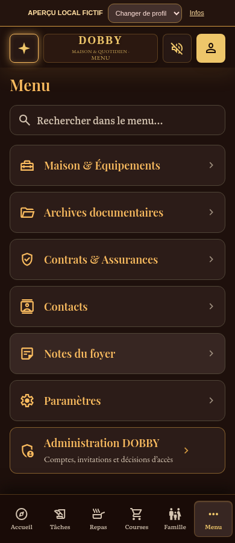
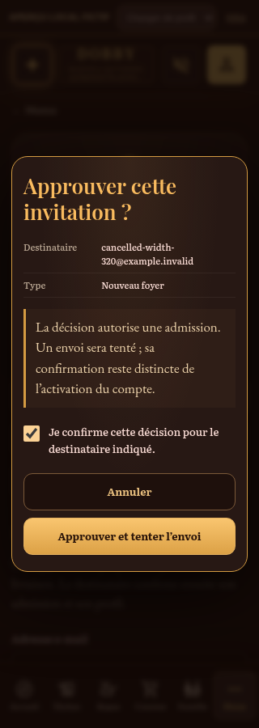

# Lot 4 — captures de la vraie V7

Données strictement fictives. Chrome 154, services Auth/SQL/SMTP locaux réels, aucune interception Playwright. Le bandeau distingue cet aperçu de la production.

| Vue Accès | 320 px | 390 px | 768 px | 1440 px |
| --- | --- | --- | --- | --- |
| Header et six rubriques du dock | [Ouvrir](admin-access-320.png) | [Ouvrir](admin-access-390.png) | [Ouvrir](admin-access-768.png) | [Ouvrir](admin-access-1440.png) |

## Parcours

| État | Capture |
| --- | --- |
| Confirmation à 320 px | [Ouvrir](invite-confirmation-320.png) |
| Inviter | [Ouvrir](admin-invite-390.png) |
| Demandes familiales | [Ouvrir](admin-requests-390.png) |
| Suspendre / Réactiver | [Ouvrir](admin-status-390.png) |
| Historique | [Ouvrir](admin-history-390.png) |
| Entrée propriétaire distincte des Paramètres | [Ouvrir](owner-menu-390.png) |
| Liste sans données | [Ouvrir](empty-requests-390.png) |
| Après admission réelle de l’adulte | [Ouvrir](adult-admitted-390.png) |
| Livraison incertaine après tentative SMTP réelle | [Ouvrir](delivery-uncertain-390.png) |
| Demandes longues et pagination | [Ouvrir](long-requests-390.png) |
| Erreur réseau sans anciennes données privilégiées | [Ouvrir](network-error-390.png) |
| Compte suspendu, envois locaux conservés | [Ouvrir](suspended-queue-preserved-390.png) |

[Résultats, empreintes et limites](results.json). [Rapport du Lot 4](../../../administration-privee/lot4/RAPPORT.md).

[Complément : les six rendus d’états aux quatre largeurs](../responsive-states/INDEX.md).
