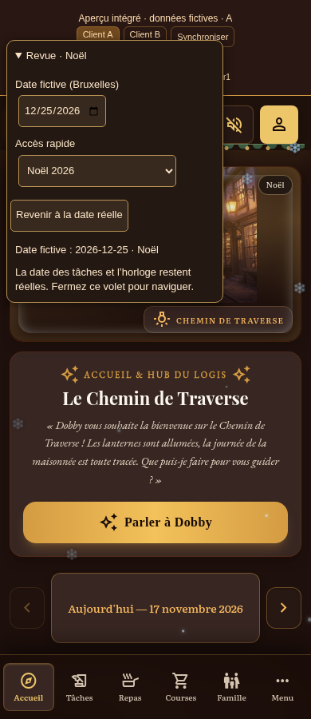

# DOBBY V7 — Ambiances saisonnières automatiques

Implémentation de l’[issue #21](https://github.com/PortenartCo/dobby-demo/issues/21), depuis `main` vérifié au commit `2f2f38b197a96ee2ae3593545f822002a452e859`. Livraison applicative sur branche dédiée ; aperçu publié par ajout d’un dossier uniquement, expressément autorisé par le propriétaire. Aucune fusion applicative ni modification des comptes réels.

## Comportement

Le calendrier pur `essai-stitch-v7/seasonal-calendar.js` utilise la date civile Europe/Brussels, indépendamment du fuseau de l’appareil. Il calcule Pâques grégorien, Mardi gras (Pâques − 47 jours) et le quatrième jeudi de novembre. Les fenêtres sont inclusives. Hiver : 01/12–19/03 ; printemps : 20/03–31/05 ; été : 01/06–31/08 ; automne : 01/09–30/11.

| Fête | Fenêtre annuelle |
| --- | --- |
| Journée de la magie | 31 janvier uniquement |
| Saint-Valentin | 12–14 février |
| Carnaval | Mardi gras − 2 jours à Mardi gras |
| Pâques | Dimanche de Pâques − 7 jours à lundi de Pâques |
| Fête nationale belge | 20–21 juillet |
| Halloween | 24 octobre–1er novembre |
| Thanksgiving américain | Quatrième jeudi de novembre − 2 jours à + 3 jours |
| Saint-Nicolas | 1er–6 décembre |
| Noël | 7–26 décembre |
| Nouvel An | 27 décembre–1er janvier |

Une seule fête remplace visuellement la saison. Saint-Valentin prévaut sur Carnaval pendant toute sa fenêtre. Saint-Nicolas prévaut sur Thanksgiving le 1er décembre lorsque les deux fenêtres se recoupent (exemples : 2024, 2030). Les autres fenêtres ne se recoupent pas.

Le moteur se recalcule à l’ouverture, au retour (focus, pageshow et visibilitychange), à la prochaine minuit bruxelloise et au remplacement d’un écran. Un seul timer local vise la prochaine minuit ; il est suspendu lorsque la page est masquée. Aucun service, tâche externe, IA, cron ou Supabase.

## Intégration native

Le réglage `st.stitchPreferences.seasonalDecorations` est activé par défaut et sauvegardé par le `save()` existant. Paramètres > Ambiance magique propose Décorations saisonnières, Effets magiques et Sons. Les interrupteurs conservent leur rôle accessible et l’usage au clavier.

- Décorations OFF : aucun marqueur ni coloration saisonnière ; l’ambiance dorée native reste disponible.
- Effets OFF : les décorations restent statiques, sans particules ni séquence animée.
- Animations réduites : repères statiques conservés, aucune animation saisonnière.
- Sons : préférence indépendante ; le calendrier, le retour dans l’application et les décors ne déclenchent jamais de son.

L’adaptateur utilise les 22 particules E01/FAM existantes ; aucun deuxième émetteur permanent. Les éléments sont absolus et transparents aux clics, sans déplacement du header/dock ni changement de l’illustration. Le 31 janvier ajoute huit runes pendant cinq secondes maximum, une seule fois par session et année ; le marqueur de visionnage est distinct d’une préférence, propre au chemin de l’application et tolère un stockage indisponible. Réduction des animations, désactivation des effets et départ de page interrompent la séquence.

## Aperçu et preuves

Le constructeur `scripts/build-dobby-seasonal-review.cjs` étend le constructeur consolidé existant. Il refuse le remplacement d’un dossier et les sources non commitées pour une publication. `--allow-dirty` est réservé à l’essai local. Chaque fichier est inventorié avec son empreinte SHA-256, la source et les transformations héritées.

Le volet « Revue des saisons » propose les 14 ambiances et une date libre ; la date de revue ne change ni `Date`, ni l’horloge du moteur métier, ni les dates des tâches. Il persiste seulement dans la session du namespace de cet aperçu. Le bouton Date réelle le désactive. Aucun contrôle ni paramètre d’URL de date n’est ajouté aux routes natives. Le runtime/CSP existant bloque les connexions externes et conserve les données fictives isolées.

Les résultats définitifs, SHAs et liens de publication sont dans [livraison.md](livraison.md).

## Captures comparatives

Captures Chromium, profils jetables ; les vues de référence utilisent Décorations OFF avec l’ambiance native active, à la même date que Noël. Les originaux restent identiques.

| Largeur | Référence native | Noël |
| --- | --- | --- |
| 320 px |  |  |
| 390 px |  |  |
| 768 px |  |  |
| 1440 px |  |  |

Les captures de toutes les périodes, des paramètres, des effets OFF et des animations réduites figurent dans `evidence/`.
