# DOBBY — Habillage des fêtes, revue visuelle

Base : `fa37fd2967b84b2e3caf50198f75391d41370afd`. Source visuelle : `73fbdc90cf8ad921878f0487be836209fc887631`. Même PR #26, sans fusion applicative. Décision produit : issue #21, mise à jour UX du 17 novembre 2026.

Les grandes fêtes ont maintenant un encadrement illustré, un header composé et un panneau d’accueil coordonné. Les ornements SVG sont dessinés localement et placés dans les coins et les espaces latéraux, avec le centre du portrait libre. Noël utilise sapin, houx, boules et cadeaux ; Halloween des citrouilles sculptées, lanternes, chauves-souris et une brume statique ; le Nouvel An des rubans métalliques, étoiles et confettis noir-or. Les fêtes intermédiaires ont leurs motifs propres ; le 31 janvier conserve sa séquence native et ajoute baguette et aura statiques.

Le calendrier, ses priorités et son fuseau, les préférences, les sons, les données, le constructeur protégé et les illustrations d’origine restent inchangés. Aucun nouveau stockage, service, dépendance ou appel réseau. Une bibliothèque SVG partagée est créée uniquement pour les événements et retirée avec les décors. Les seules animations ajoutées sont l’opacité des petites lumières, conditionnée par les réglages natifs, la visibilité et la réduction des animations.

## Comparaisons statiques

Toutes ces captures sont prises avec **Effets magiques OFF** et **Sons OFF**, Décorations ON. La référence utilise les fichiers JS/CSS exacts du SHA vert `fa37fd2`, interceptés dans un profil de test jetable ; les autres fichiers sont identiques. Les captures « sans étiquette » masquent uniquement le badge dans le navigateur de test pour vérifier la reconnaissance du décor. L’horloge de test rend les captures reproductibles ; le sélecteur de revue publié continue de ne changer que le décor, jamais les dates métier.

### Noël

| Largeur | Avant | Après |
| --- | --- | --- |
| 320 | [Avant](before/christmas-320.png) | [Après](after/christmas-320.png) |
| 390 |  | 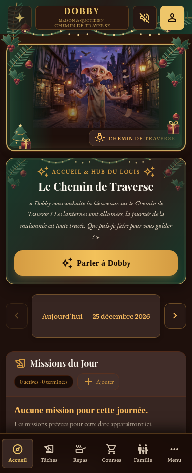 |
| 768 | [Avant](before/christmas-768.png) | [Après](after/christmas-768.png) |
| 1440 | 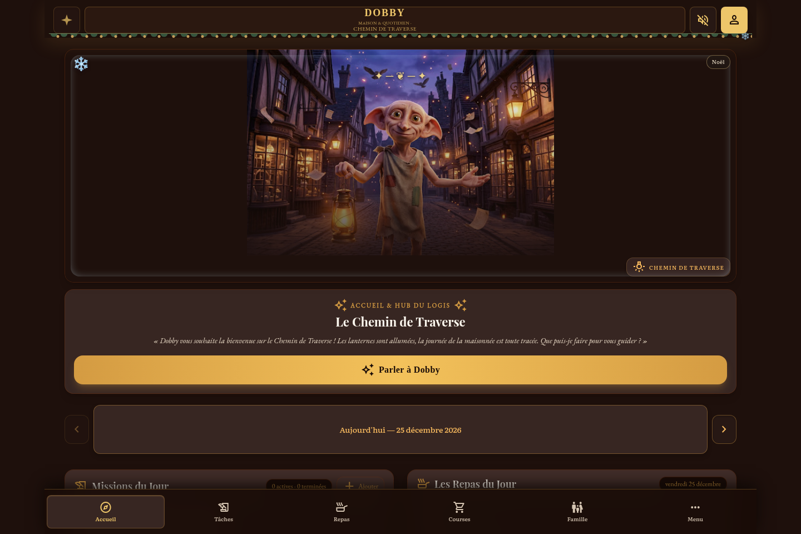 | 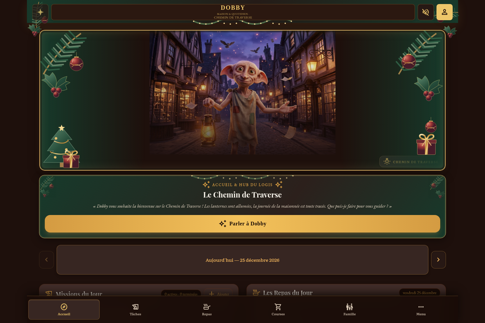 |

### Halloween

| Largeur | Avant | Après |
| --- | --- | --- |
| 320 | [Avant](before/halloween-320.png) | [Après](after/halloween-320.png) |
| 390 | 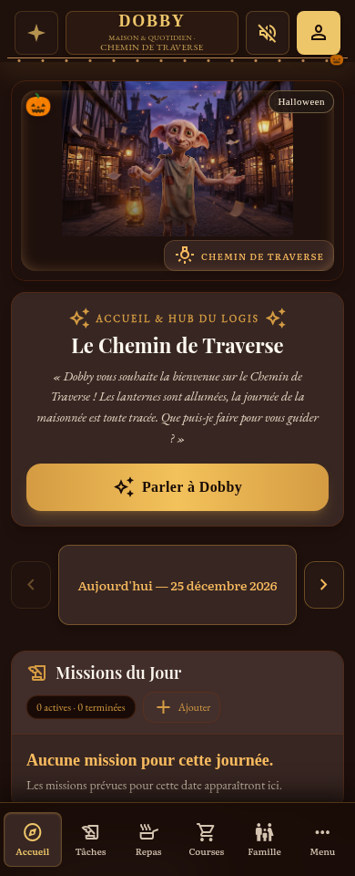 | 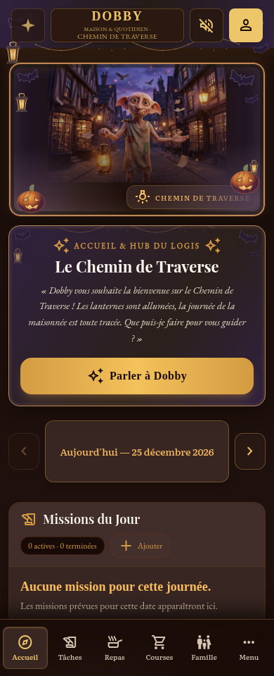 |
| 768 | [Avant](before/halloween-768.png) | [Après](after/halloween-768.png) |
| 1440 | 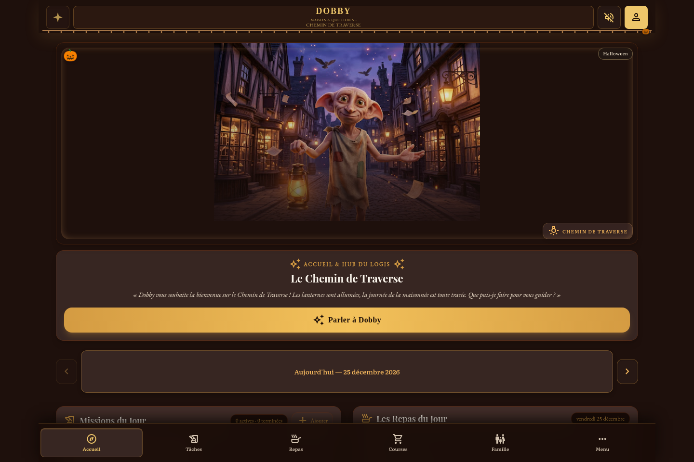 | 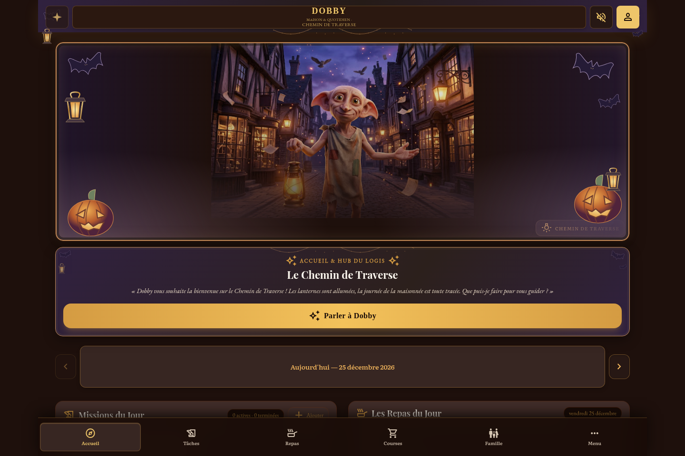 |

### Nouvel An

| Largeur | Avant | Après |
| --- | --- | --- |
| 320 | [Avant](before/new-year-320.png) | [Après](after/new-year-320.png) |
| 390 |  | 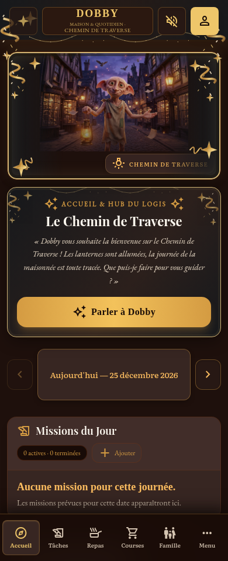 |
| 768 | [Avant](before/new-year-768.png) | [Après](after/new-year-768.png) |
| 1440 |  | 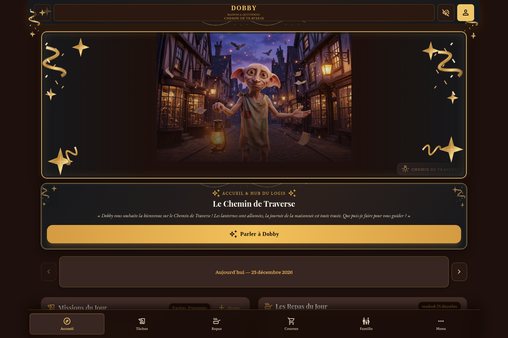 |

### Saint-Valentin — fête intermédiaire

| Largeur | Avant | Après |
| --- | --- | --- |
| 320 | [Avant](before/valentine-320.png) | [Après](after/valentine-320.png) |
| 390 | 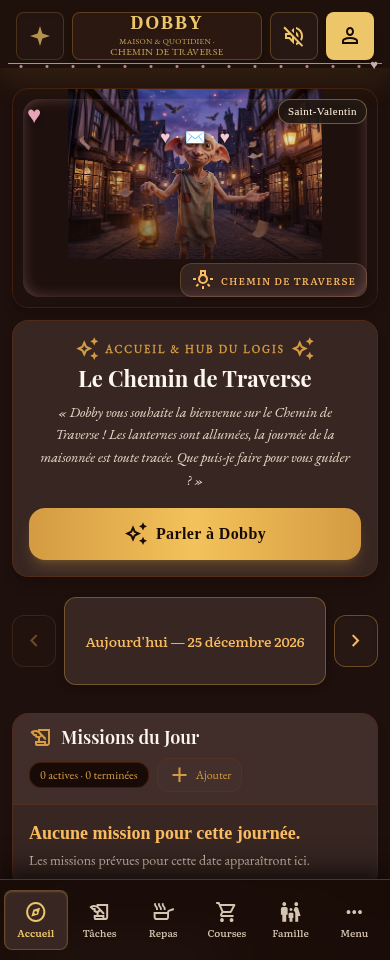 | 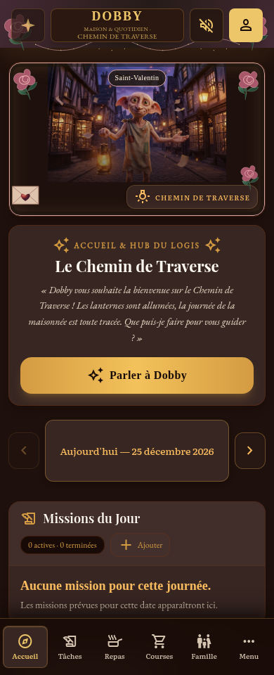 |
| 768 | [Avant](before/valentine-768.png) | [Après](after/valentine-768.png) |
| 1440 |  | 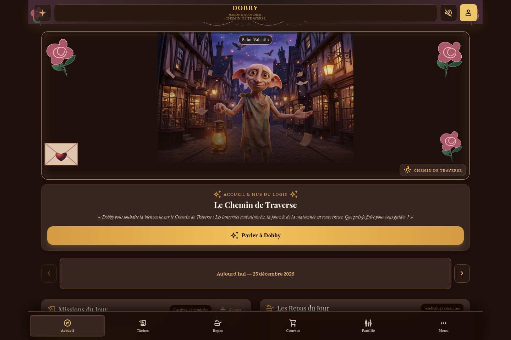 |

## Non-régression et limites

- Les huit captures des quatre saisons à 390 et 1440 sont **identiques octet pour octet** avant/après : [empreintes](seasons-comparison.json). Un écart de taille de badge PC a été reproduit puis corrigé en limitant la règle aux fêtes.
- Les contrôles visuels couvrent les quatre largeurs, les motifs des six fêtes intermédiaires et de la magie, les boutons traversant les calques, l’absence de débordement, les dimensions inchangées du header/dock et la restauration de l’apparence ordinaire lorsque Décorations est OFF.
- Les SVG restent bornés à moins de 420 éléments de décor, sans émetteur de particules supplémentaire. Effets OFF donne zéro animation saisonnière ; les réglages et la réduction des animations restent couverts par les tests natifs.
- Les 14 tests transversaux restent verts ; aucun des 11 manifestes historiques ni `build-source.cjs` n’a changé. Aucune nouvelle preuve de modification du constructeur n’est nécessaire.
- Contre-revue indépendante des captures sans étiquette : les trois grandes fêtes sont identifiables, le visage et les proportions de Dobby restent dégagés, aucun défaut matériel relevé après correction de la règle de typographie.
- Vérification sur Chromium Linux. Recette physique Safari/iPhone non réalisée ; validation artistique finale réservée au propriétaire. Statut : **READY_FOR_REVIEW**.

Les journaux locaux et liens vers la nouvelle publication sont dans [livraison.md](livraison.md). Les résultats CI du HEAD final figurent dans la description de la PR #26.
